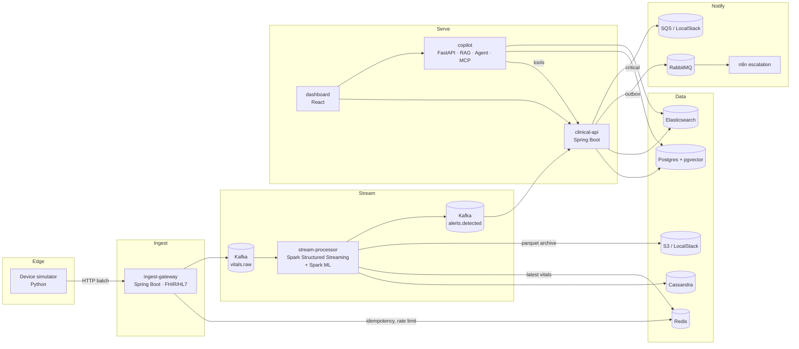

# VitalStream

**Real-time clinical telemetry platform with an AI clinical copilot.**

VitalStream ingests high-volume patient vital signs from bedside devices (FHIR R4, HL7 v2, and a compact device batch format), processes them as a stream to detect clinical deterioration (thresholds, trend z-scores, NEWS2 early-warning score, Spark ML anomaly model), routes alerts to clinicians, and gives clinicians an AI copilot that answers questions grounded in live patient data and clinical guidelines (RAG + agent + MCP).

> Synthetic data only. Not a medical device. Built as an end-to-end showcase of modern backend, data and AI engineering.

## Architecture



## Tech stack

| Area | Technologies |
|---|---|
| Languages | Java 21 (Spring Boot), Python 3.12, TypeScript |
| Streaming & messaging | Apache Kafka (KRaft), RabbitMQ, AWS SQS |
| Processing / ML | Apache Spark Structured Streaming, Spark ML |
| Storage | PostgreSQL + pgvector, Cassandra, Redis, Elasticsearch, S3 |
| AI | LLM (Claude, pluggable), RAG with hybrid search, LangGraph / DeepAgents, MCP server |
| Healthcare standards | FHIR R4, HL7 v2 (ORU^R01), LOINC, UCUM |
| Infra | Docker, Docker Compose, Kubernetes (kind), Helm, Terraform (AWS: EKS, RDS, MSK, ElastiCache, SQS, S3, ECR), LocalStack |
| CI/CD | GitHub Actions, Jenkinsfile |
| Observability | Structured JSON logs with correlation IDs, Prometheus, Grafana |
| Automation | n8n |

## Repository layout

```
contracts/          Shared event schemas + sample payloads (source of truth: docs/CONTRACTS.md)
infra/              Docker Compose for all infrastructure + init scripts
services/
  ingest-gateway/   Java · Spring Boot · FHIR/HL7 ingestion → Kafka
  stream-processor/ PySpark streaming + Spark ML anomaly detection
  clinical-api/     Java · Spring Boot · alerts, patients, search, notifications
  copilot/          Python · FastAPI · RAG + agent + MCP server
tools/simulator/    Synthetic patient/device generator + load test
web/dashboard/      React dashboard (live vitals, alerts, copilot chat)
deploy/             Helm chart, kind config, Terraform for AWS
docs/               Architecture, contracts, workflow, ADRs, images
```

## Quick start

```bash
cp .env.example .env          # optional: set ANTHROPIC_API_KEY for the real LLM
make up                       # infra + all services
make simulate                 # stream synthetic patients
open http://localhost:3000    # dashboard
```

See [docs/CONTRACTS.md](docs/CONTRACTS.md) for ports, topics and schemas, and [CONTRIBUTING.md](CONTRIBUTING.md) for engineering rules.

## How this project was built

Built by a team of AI agents: one manager agent (architecture, task split, review, merge) and parallel worker agents, each owning one component on its own branch and PR, test-first. The process is documented in [docs/WORKFLOW.html](docs/WORKFLOW.html).

## License

MIT
