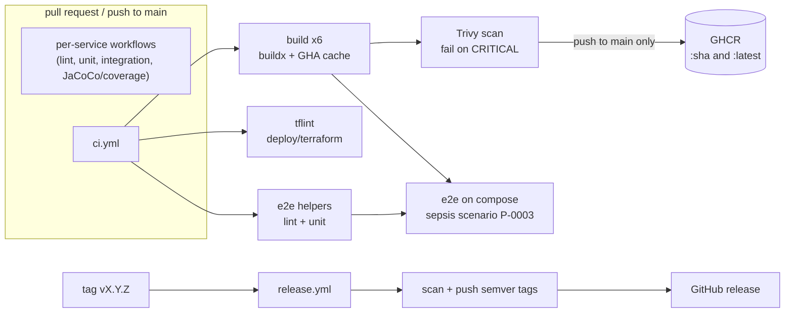
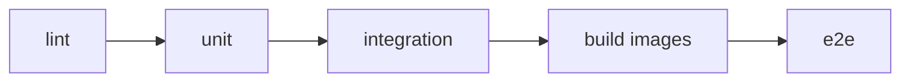

# Delivery: CI, release and end-to-end

How code gets from a pull request to a published image, and how the whole platform is proven to work together.

## Pipelines at a glance



The same stages exist for other CI systems, built from the same commands:



| Pipeline | File | Trigger | What it does |
|---|---|---|---|
| Per-service | `.github/workflows/<service>.yml` | PR / push with `paths:` filter | lint, unit, integration tests, coverage gate for one component (owned by that component) |
| CI | `.github/workflows/ci.yml` | every PR, push to `main` | image build matrix, Trivy scan, GHCR push (main only), tflint, e2e helper tests, e2e on compose |
| Release | `.github/workflows/release.yml` | tag `vX.Y.Z` | scan, push `X.Y.Z`, `X.Y` and `sha-<short>` tags, create the GitHub release with generated notes |
| Jenkins | `Jenkinsfile` | your Jenkins | lint, unit, integration, build images, e2e; parallel per service inside each stage |
| GitLab | `.gitlab-ci.yml` | your GitLab | same stages; each service job has `rules:changes` on its own paths and `contracts/` |

### ci.yml in detail

* **build** (matrix of 6): `docker/build-push-action` builds with buildx and the GitHub Actions cache (one cache scope per service). The image is loaded locally and scanned by **Trivy** (`scanners: vuln,secret`; `severity: CRITICAL`, `ignore-unfixed: true`, `exit-code: 1`), so a CRITICAL CVE that has a fix blocks the merge, an unfixable one does not. On a push to `main` the job logs in to GHCR with `GITHUB_TOKEN` (`permissions: packages: write`, job-scoped) and pushes `:<commit sha>` and `:latest` from the same cache (no rebuild).
* **tflint**: official `terraform-linters/setup-tflint`, `tflint --recursive` over `deploy/terraform` (all roots and modules, bundled `terraform` ruleset).
* **e2e-unit**: ruff, mypy `--strict` and pytest (80 % gate) for the `e2e/` helpers.
* **e2e** (`needs: build, e2e-unit`): `make infra-up`, then every component through the Makefile's compose files, then the pipeline suite below; tears everything down and dumps container logs on failure.
* All third-party actions are pinned to a commit SHA of a release older than two weeks (the tag is in a comment). Workflow permissions default to `contents: read`.

### Image names

| Service | Image |
|---|---|
| ingest-gateway | `ghcr.io/ilay-fisher/vitalstream-ingest-gateway` |
| stream-processor | `ghcr.io/ilay-fisher/vitalstream-stream-processor` |
| clinical-api | `ghcr.io/ilay-fisher/vitalstream-clinical-api` |
| copilot | `ghcr.io/ilay-fisher/vitalstream-copilot` |
| simulator | `ghcr.io/ilay-fisher/vitalstream-simulator` |
| dashboard | `ghcr.io/ilay-fisher/vitalstream-dashboard` |

Tags: `<full commit sha>` and `latest` from `main`; `X.Y.Z`, `X.Y`, `sha-<short>` from a release tag. The Helm chart and Terraform ECR module take these names.

## End-to-end suite (`e2e/`)

One scenario, asserted hop by hop with polling and hard timeouts (`vitalstream_e2e.polling.poll_until`):

| # | Step | Evidence |
|---|---|---|
| 1 | ingest-gateway answers `202` to a probe reading for P-0003 | HTTP status, `accepted: 1` |
| 2 | the probe event (by `eventId`) appears on `vitals.raw`, keyed by patient, with a `correlationId` header | Kafka tail |
| 3 | the simulator's sepsis run for P-0003 completed and its readings flowed through | record count |
| 4 | stream-processor raises an alert for P-0003 on `alerts.detected` | Kafka tail |
| 5 | `GET /api/v1/alerts?patientId=P-0003` on clinical-api lists it | REST |
| 6 | `GET /api/v1/alerts/stream` (SSE, opened *before* the run, the feed has no replay) delivered an `alert` event | SSE collector |
| 7 | `POST /alerts/{id}/ack` returns `200`, the second `409` | REST |
| 8 | copilot `POST /api/v1/chat` (`LLM_PROVIDER=fake`) streams a `tool_call` to a clinical-api tool and ends with `done` without `error` | SSE |

### Run it locally

Prerequisites: Docker (Colima on macOS, see CONTRIBUTING section 7), `make`, `uv`.

```bash
export DOCKER_HOST=unix://$HOME/.colima/default/docker.sock
cd e2e
uv sync
uv run pytest                              # helper unit tests, no Docker
uv run pytest -m e2e -o addopts="" -v -s   # the real thing: brings the stack up, runs, tears down
```

| Variable | Default | Meaning |
|---|---|---|
| `E2E_TEARDOWN` | auto | `all` removes the whole stack, `services` only the five components, `none` leaves it running. Auto = `all` if the suite started the infrastructure, `services` if infra was already up (it never stops infra it did not start) |
| `E2E_SKIP_BUILD` | unset | set to reuse already-built images (`up --no-build`) |
| `E2E_SIM_DURATION` / `E2E_SIM_SPEED` | `150` / `20x` | simulator run length (seconds) and scenario speed |
| `INGEST_GATEWAY_URL`, `CLINICAL_API_URL`, `COPILOT_URL`, `KAFKA_BOOTSTRAP_SERVERS`, `INGEST_API_KEY` | host defaults from CONTRACTS | point the suite at another stack |

The suite uses the Makefile's compose files plus `e2e/compose.e2e.yaml`, which caps heaps (Java `-Xmx`, Spark driver 1 GB, `mem_limit` per container, CONTRIBUTING section 7). It also works around two problems in `services/stream-processor/compose.yaml` (see "Known gaps").

## Jenkins

`Jenkinsfile` is declarative: `Lint`, `Unit`, `Integration`, `Build images`, `E2E`; every stage but the last has one parallel branch per service. It needs an agent with Docker, JDK 21 (`JAVA_HOME` is set in `environment`), uv and Node 22, and the **JUnit** plugin for the `post` step.

Run it without a Jenkins server using [jenkinsfile-runner](https://github.com/jenkinsci/jenkinsfile-runner):

```bash
docker run --rm -v /var/run/docker.sock:/var/run/docker.sock \
  -v "$PWD":/workspace -w /workspace \
  jenkins/jenkinsfile-runner:latest \
  -w /app/jenkins -p /usr/share/jenkins/ref/plugins \
  --file /workspace/Jenkinsfile
```

The stock image has no Docker CLI, JDK 21 or uv; build a derived image from `jenkins/jenkinsfile-runner` that adds them (or run a stage-by-stage dry check with `--no-sandbox`). The Jenkinsfile was validated by review and by `e2e/tests/unit/test_delivery_files.py` (stage order, per-service branches, balanced braces); it was not executed on a Jenkins controller.

## GitLab CI

`.gitlab-ci.yml` has stages `lint`, `unit`, `integration`, `build`, `e2e`. Job templates (`.java`, `.uv`, `.node`, `.dind`) keep the jobs short; `.rules-<service>` templates run a job on the default branch and tags, and on merge requests only when that service's paths, `contracts/` or the pipeline file changed. Integration jobs and image builds use a `docker:27-dind` sidecar (`TESTCONTAINERS_HOST_OVERRIDE=docker`). Images are pushed to the project registry (`$CI_REGISTRY_IMAGE/<service>`) on the default branch and tags. The `e2e:compose` job needs a **shell-executor runner tagged `docker-e2e`** (Docker, make, uv), because the suite talks to the stack on loopback ports, which a dind sidecar does not expose.

Validation: the file parses as YAML and `e2e/tests/unit/test_delivery_files.py` checks stages, `extends`, `needs` and per-service coverage. GitLab's JSON schema was not available offline; `glab ci lint` or the Pipeline Editor remains the authoritative check.

## n8n escalation workflow

See [infra/n8n/README.md](../infra/n8n/README.md): flow diagram, configuration, import commands and verification.

## Known gaps

* CI e2e rebuilds the images with compose instead of reusing the ones built and scanned in the `build` job (they are not shared across jobs). The cache makes the build job cheap; the e2e job pays a cold build.
* `services/stream-processor/compose.yaml` (not owned here) uses `build.context: .`, which resolves to the repository root under `--project-directory .`, and names the shared network under the key `default` instead of `vitalstream`. `make up` therefore fails on a clean checkout; the e2e override fixes both for the suite only. The component owner should fix the fragment.
* Trivy scans `vuln,secret` with `ignore-unfixed`, so a CVE without a fix does not fail the build. Base images were patched instead of ignored (`apk upgrade` in the dashboard image, `dpkg --purge linux-libc-dev` in stream-processor). What remains is exact CVE IDs, per service (`e2e/ci/trivy-ignore-<service>.rego`), each with a reason and an expiry of 2026-12-15: four Spark-bundled jar CVEs in stream-processor. One scoped secret-scan allowlist (`e2e/ci/trivy-secret.yaml`) covers a masked-placeholder docstring in the Anthropic SDK.
* The Jenkinsfile and GitLab file were not executed on real Jenkins/GitLab instances.
* The n8n workflow imports into the running n8n 1.64.3 (`n8n import:workflow`), but it has not been exercised with a live RabbitMQ delivery (the Wait node is minutes long) and the canvas screenshot is pending the manual owner-account step described in `infra/n8n/README.md`.
