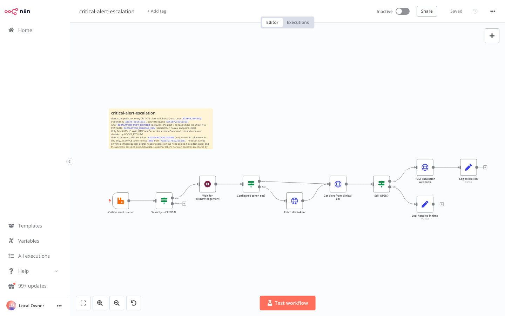
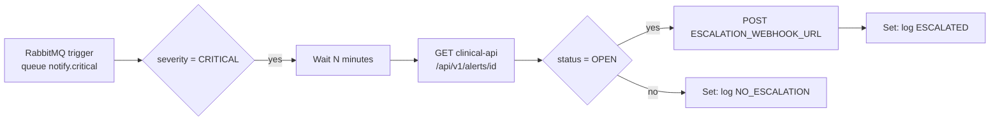

# n8n: critical-alert-escalation

Importable workflow that escalates CRITICAL alerts nobody has acknowledged.





## How it follows the contracts

* clinical-api publishes each alert to the topic exchange `alerts.notify` with routing key `alert.<severity>` (CONTRACTS section 5). The queue `notify.critical` is bound to `alert.critical`, so the trigger consumes only CRITICAL alerts; the IF node re-checks `severity` anyway so a rebinding cannot escalate a lower severity.
* The message body is the `AlertView` JSON; the trigger parses it (`jsonParseBody`, `onlyContent`).
* After the wait the alert is re-read from `GET /api/v1/alerts/{alertId}` (the ack endpoint changes `status` to `ACKNOWLEDGED`). Only `OPEN` alerts escalate. The request carries `X-Correlation-Id: n8n-escalation-<alertId>`.
* The queue message is acknowledged when the execution finishes, so a crash while waiting redelivers the alert (the DLX `alerts.notify.dlx` takes over after rejects).
* Nodes used: RabbitMQ Trigger, IF, Wait, HTTP Request, Set. `executeCommand`, `ssh` and `code` are in `NODES_EXCLUDE` (infra/compose.yaml) and are not used.
* "Log" is the Set node `log` field: n8n stores it in the execution data (Executions tab), which is the audit trail. A failed webhook POST does not fail the run (`onError: continueRegularOutput`); the log line says `failed (...)`.

## Configuration (n8n container environment)

| Variable | Default | Meaning |
|---|---|---|
| `ESCALATION_WAIT_MINUTES` | `5` | Minutes to wait before re-checking the alert |
| `ESCALATION_WEBHOOK_URL` | empty (placeholder) | Where to POST the escalation. No real endpoint is shipped; while empty the POST fails and the log says so |
| `CLINICAL_API_URL` | `http://clinical-api:8082` | clinical-api base URL inside the `vitalstream` network |

`infra/compose.yaml` does not pass these through; set them with an override file of your own (for example `docker compose ... -f my-n8n.override.yaml`) or accept the defaults.

## Import into the running n8n

```bash
N8N_PROXY_PASSWORD=choose-one make infra-up PROFILES=tools   # n8n + Caddy proxy on 127.0.0.1:5678

docker cp infra/n8n/credentials/rabbitmq.dev.json vitalstream-n8n:/tmp/rabbitmq.dev.json
docker cp infra/n8n/critical-alert-escalation.json vitalstream-n8n:/tmp/critical-alert-escalation.json
docker exec vitalstream-n8n n8n import:credentials --input=/tmp/rabbitmq.dev.json
docker exec vitalstream-n8n n8n import:workflow --input=/tmp/critical-alert-escalation.json
docker exec vitalstream-n8n n8n list:workflow
```

`credentials/rabbitmq.dev.json` holds the published local-dev RabbitMQ login (`vitalstream`/`vitalstream`, CONTRACTS section 1). Never reuse it outside local development; in any shared environment create the credential in the n8n UI instead.

The workflow imports inactive. Activate it in the UI (toggle top right) or with `n8n update:workflow --id=vs-critical-alert-escalation --active=true` and restart n8n.

## Verification

`make infra-up PROFILES=tools` then the import above printed `Successfully imported 1 workflow.` and `n8n list:workflow` listed `vs-critical-alert-escalation|critical-alert-escalation`. The canvas screenshot above was taken from that instance with Playwright.
