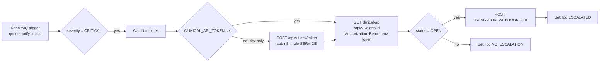

# n8n: critical-alert-escalation

Importable workflow that escalates CRITICAL alerts nobody has acknowledged.



## How it follows the contracts

* clinical-api publishes each alert to the topic exchange `alerts.notify` with routing key `alert.<severity>` (CONTRACTS section 5). The queue `notify.critical` is bound to `alert.critical`, so the trigger consumes only CRITICAL alerts; the IF node re-checks `severity` anyway so a rebinding cannot escalate a lower severity.
* The message body is the `AlertView` JSON; the trigger parses it (`jsonParseBody`, `onlyContent`).
* After the wait the alert is re-read from `GET /api/v1/alerts/{alertId}` (the ack endpoint changes `status` to `ACKNOWLEDGED`). Only `OPEN` alerts escalate. The request carries `X-Correlation-Id: n8n-escalation-<alertId>` and `Authorization: Bearer <token>`: clinical-api requires a JWT (CONTRACTS section 4.2) and any role may read, so a `SERVICE` token is enough.
* Where the token comes from: the env var `CLINICAL_API_TOKEN` when it is set (the way to run anywhere but a developer machine). Otherwise a preceding node (`Fetch dev token`) asks clinical-api's dev endpoint `POST /api/v1/dev/token` for a `SERVICE` token for sub `n8n`; that endpoint only exists with `CLINICAL_DEV_TOKENS_ENABLED=true` (set by the local compose file only), `APP_ENV=dev` and no JWKS, so elsewhere the workflow fails at that node rather than working without credentials. No token is stored in the workflow file. The HTTP node's header expression is `Bearer {{ $env.CLINICAL_API_TOKEN || $('Fetch dev token').item.json.token }}`, the only place a token is read: no Set node copies it into item data. n8n would still save the dev-token node's response with the execution, so the workflow settings (`saveDataSuccessExecution`, `saveDataErrorExecution`: `none`, `saveManualExecutions`: `false`) and the n8n service (`EXECUTIONS_DATA_SAVE_ON_SUCCESS=none`, `EXECUTIONS_DATA_SAVE_ON_ERROR=none` in `infra/compose.yaml`) keep no execution data at all: neither tokens nor alert contents (PHI) end up in the n8n database. The cost: the Executions tab is empty, so the "Log" Set nodes are visible only while debugging a manual run in the editor; turn saving on locally only with synthetic data.
* The queue message is acknowledged when the execution finishes, so a crash while waiting redelivers the alert (the DLX `alerts.notify.dlx` takes over after rejects).
* Nodes used: RabbitMQ Trigger, IF, Wait, HTTP Request, Set. `executeCommand`, `ssh` and `code` are in `NODES_EXCLUDE` (infra/compose.yaml) and are not used.
* "Log" is the Set node `log` field. Because no execution data is saved (see above) it is not kept; clinical-api's own audit log records the acknowledgements. A failed webhook POST does not fail the run (`onError: continueRegularOutput`); the log line says `failed (...)`.

## Configuration (n8n container environment)

| Variable | Default | Meaning |
|---|---|---|
| `ESCALATION_WAIT_MINUTES` | `5` | Minutes to wait before re-checking the alert |
| `ESCALATION_WEBHOOK_URL` | empty (placeholder) | Where to POST the escalation. No real endpoint is shipped; while empty the POST fails and the log says so |
| `CLINICAL_API_URL` | `http://clinical-api:8082` | clinical-api base URL inside the `vitalstream` network |
| `CLINICAL_API_TOKEN` | empty | JWT (role `SERVICE`, `aud` `clinical-api`) for clinical-api. Empty: the workflow fetches a dev token (dev only). `infra/compose.yaml` passes it from the host environment: `CLINICAL_API_TOKEN=... make infra-up PROFILES=tools` |

`infra/compose.yaml` passes only `CLINICAL_API_TOKEN` through; set the others with an override file of your own (for example `docker compose ... -f my-n8n.override.yaml`) or accept the defaults.

## Import into the running n8n

```bash
N8N_PROXY_PASSWORD=choose-one make infra-up PROFILES=tools   # n8n + Caddy proxy on 127.0.0.1:5678

docker cp infra/n8n/credentials/rabbitmq.dev.json vitalstream-n8n:/tmp/rabbitmq.dev.json
docker cp infra/n8n/critical-alert-escalation.json vitalstream-n8n:/tmp/critical-alert-escalation.json
docker exec vitalstream-n8n n8n import:credentials --input=/tmp/rabbitmq.dev.json
docker exec vitalstream-n8n n8n import:workflow --input=/tmp/critical-alert-escalation.json
docker exec vitalstream-n8n n8n list:workflow
```

`credentials/rabbitmq.dev.json` holds the published local-dev RabbitMQ login (`vitalstream`/`vitalstream`, CONTRACTS section 1). Never reuse it outside local development; in any shared environment create the credential in the n8n UI instead.

The workflow imports inactive. Activate it in the UI (toggle top right) or with `n8n update:workflow --id=vs-critical-alert-escalation --active=true` and restart n8n.

## Verification

Against the `n8nio/n8n:1.123.94` image pinned in `infra/compose.yaml` (profile `tools`; tag plus digest, bumped from 1.64.3 for the security advisories fixed up to 1.123.89):

```
$ docker exec vitalstream-n8n n8n import:credentials --input=/tmp/rabbitmq.dev.json
Successfully imported 1 credential.
$ docker exec vitalstream-n8n n8n import:workflow --input=/tmp/critical-alert-escalation.json
Successfully imported 1 workflow.
$ docker exec vitalstream-n8n n8n list:workflow
vs-critical-alert-escalation|critical-alert-escalation
```

On the same image, `GET /types/nodes.json` (behind the proxy, logged in) lists `rabbitmqTrigger`, `if`, `wait`, `httpRequest` and `set` with the `typeVersion` this workflow uses, and none of `executeCommand`, `ssh`, `code` (`NODES_EXCLUDE` still takes the `n8n-nodes-base.*` names).

`e2e/tests/unit/test_delivery_files.py` additionally checks that no excluded node type is used, that every connection points at an existing node, that `Authorization` is set only in the clinical-api HTTP node header, read from the env token or the dev-token node, that no Set node carries a token, that the workflow saves no execution data, that the dev fetch asks for sub `n8n` with role `SERVICE`, that no JWT is committed, and that the compose n8n service passes `CLINICAL_API_TOKEN` and saves no execution data.

### Canvas screenshot (`docs/images/n8n-escalation.png`)


Captured 2026-11-12 from the imported workflow in a local n8n 1.64.3 (not recaptured on 1.123.94). n8n only renders the editor after an owner account exists. For local use, keep a throwaway login in a gitignored `infra/n8n/.env` (the root `.gitignore` covers `.env`), with generated values and never a real password:

```bash
N8N_PROXY_USER=admin
N8N_PROXY_PASSWORD=<generated>
N8N_OWNER_EMAIL=owner@vitalstream.test
N8N_OWNER_FIRST_NAME=Local
N8N_OWNER_LAST_NAME=Owner
N8N_OWNER_PASSWORD=<generated, 8+ chars, a digit and an uppercase letter>
```

Then, with `set -a; . infra/n8n/.env; set +a`, start n8n (`make infra-up PROFILES=tools`), import as above, and create the owner once through the proxy: `POST http://127.0.0.1:5678/rest/owner/setup` with `{"email","firstName","lastName","password"}` and the proxy basic auth. The screenshot is a Playwright page at 1440x900 with `httpCredentials` for the proxy, `POST /rest/login` with `{"emailOrLdapLoginId","password"}` (1.64 took `{"email","password"}`), then `/workflow/vs-critical-alert-escalation` and Zoom to Fit.
