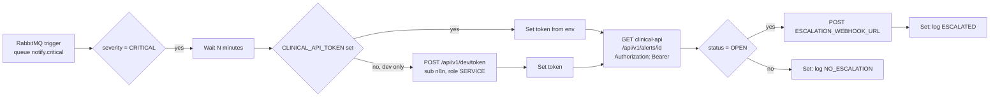

# n8n: critical-alert-escalation

Importable workflow that escalates CRITICAL alerts nobody has acknowledged.



## How it follows the contracts

* clinical-api publishes each alert to the topic exchange `alerts.notify` with routing key `alert.<severity>` (CONTRACTS section 5). The queue `notify.critical` is bound to `alert.critical`, so the trigger consumes only CRITICAL alerts; the IF node re-checks `severity` anyway so a rebinding cannot escalate a lower severity.
* The message body is the `AlertView` JSON; the trigger parses it (`jsonParseBody`, `onlyContent`).
* After the wait the alert is re-read from `GET /api/v1/alerts/{alertId}` (the ack endpoint changes `status` to `ACKNOWLEDGED`). Only `OPEN` alerts escalate. The request carries `X-Correlation-Id: n8n-escalation-<alertId>` and `Authorization: Bearer <token>`: clinical-api requires a JWT (CONTRACTS section 4.2) and any role may read, so a `SERVICE` token is enough.
* Where the token comes from: the env var `CLINICAL_API_TOKEN` when it is set (the way to run anywhere but a developer machine). Otherwise a preceding node asks clinical-api's dev endpoint `POST /api/v1/dev/token` for a `SERVICE` token for sub `n8n`; that endpoint only exists with `APP_ENV=dev` and no JWKS, so elsewhere the workflow fails at that node rather than working without credentials. No token is stored in the workflow file. The token is a field of the node output, so it is visible in the execution data of the n8n UI; treat access to n8n accordingly.
* The queue message is acknowledged when the execution finishes, so a crash while waiting redelivers the alert (the DLX `alerts.notify.dlx` takes over after rejects).
* Nodes used: RabbitMQ Trigger, IF, Wait, HTTP Request, Set. `executeCommand`, `ssh` and `code` are in `NODES_EXCLUDE` (infra/compose.yaml) and are not used.
* "Log" is the Set node `log` field: n8n stores it in the execution data (Executions tab), which is the audit trail. A failed webhook POST does not fail the run (`onError: continueRegularOutput`); the log line says `failed (...)`.

## Configuration (n8n container environment)

| Variable | Default | Meaning |
|---|---|---|
| `ESCALATION_WAIT_MINUTES` | `5` | Minutes to wait before re-checking the alert |
| `ESCALATION_WEBHOOK_URL` | empty (placeholder) | Where to POST the escalation. No real endpoint is shipped; while empty the POST fails and the log says so |
| `CLINICAL_API_URL` | `http://clinical-api:8082` | clinical-api base URL inside the `vitalstream` network |
| `CLINICAL_API_TOKEN` | empty | JWT (role `SERVICE`, `aud` `clinical-api`) for clinical-api. Empty: the workflow fetches a dev token (dev only). `infra/compose.yaml` passes it from the host environment: `CLINICAL_API_TOKEN=... make infra-up PROFILES=tools` |

`infra/compose.yaml` passes only `CLINICAL_API_TOKEN` through; set the others with an override file of your own (for example `docker compose ... -f my-n8n.override.yaml`) or accept the defaults.

## Import into the running n8n

```bash
N8N_PROXY_PASSWORD=choose-one make infra-up PROFILES=tools   # n8n + Caddy proxy on 127.0.0.1:5678

docker cp infra/n8n/credentials/rabbitmq.dev.json vitalstream-n8n:/tmp/rabbitmq.dev.json
docker cp infra/n8n/critical-alert-escalation.json vitalstream-n8n:/tmp/critical-alert-escalation.json
docker exec vitalstream-n8n n8n import:credentials --input=/tmp/rabbitmq.dev.json
docker exec vitalstream-n8n n8n import:workflow --input=/tmp/critical-alert-escalation.json
docker exec vitalstream-n8n n8n list:workflow
```

`credentials/rabbitmq.dev.json` holds the published local-dev RabbitMQ login (`vitalstream`/`vitalstream`, CONTRACTS section 1). Never reuse it outside local development; in any shared environment create the credential in the n8n UI instead.

The workflow imports inactive. Activate it in the UI (toggle top right) or with `n8n update:workflow --id=vs-critical-alert-escalation --active=true` and restart n8n.

## Verification

Against the `n8nio/n8n:1.64.3` container from `infra/compose.yaml` (profile `tools`):

```
$ docker exec vitalstream-n8n n8n import:credentials --input=/tmp/rabbitmq.dev.json
Successfully imported 1 credential.
$ docker exec vitalstream-n8n n8n import:workflow --input=/tmp/critical-alert-escalation.json
Successfully imported 1 workflow.
$ docker exec vitalstream-n8n n8n list:workflow
vs-critical-alert-escalation|critical-alert-escalation
```

After the authentication change the workflow was re-imported the same way into a fresh `vitalstream-n8n` container: `Successfully imported 1 workflow.` and `n8n list:workflow` shows it.

`e2e/tests/unit/test_delivery_files.py` additionally checks that no excluded node type is used, that every connection points at an existing node, that the clinical-api request carries `Authorization: Bearer {{ $json.token }}` fed by both token sources, that the dev fetch asks for sub `n8n` with role `SERVICE`, that no JWT is committed, and that the compose n8n service passes `CLINICAL_API_TOKEN`.

### Canvas screenshot (`docs/images/n8n-escalation.png`)

Not captured yet. n8n 1.x only renders the editor (and its `/workflows/demo` view) after the owner account exists, and creating that account is a manual step: open `http://127.0.0.1:5678` (Caddy basic auth, then the owner form), open the imported workflow, and capture it, for example with Playwright:

```js
await page.goto('http://127.0.0.1:5678/workflow/vs-critical-alert-escalation');
await page.screenshot({ path: 'docs/images/n8n-escalation.png' });
```

Note for local Colima setups: the n8n healthcheck in `infra/compose.yaml` calls `localhost`, which can resolve to `::1` while n8n listens on IPv4 only, so the container shows `unhealthy` (and `n8n-proxy`, which waits for it, does not start) even though `http://127.0.0.1:5678/healthz` answers `ok`.
