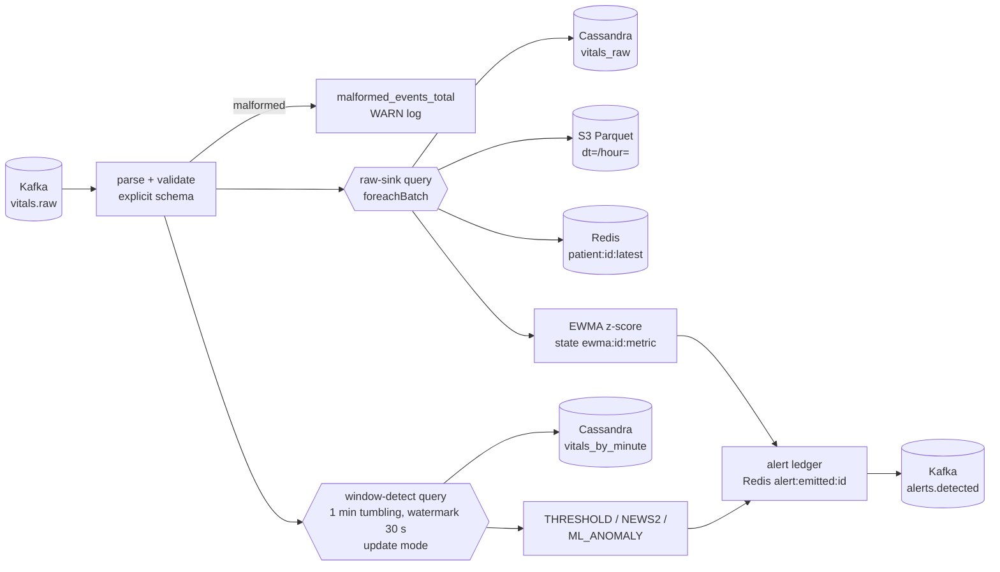

# stream-processor

PySpark Structured Streaming job that turns the raw `vitals.raw` Kafka topic into
per-minute aggregates, a hot "latest vitals" cache, a Parquet archive and clinical alerts on
`alerts.detected`. Detection rules follow [docs/CONTRACTS.md](../../docs/CONTRACTS.md) section 3.3.

| | |
|---|---|
| Spark / Java | 3.5.8 (official `apache/spark:3.5.8-scala2.12-java17-python3-ubuntu` image) |
| Python | 3.11 for development and CI (`>=3.10,<3.12`; the image's system Python 3.10 runs the same code) |
| Connectors | `spark-sql-kafka-0-10_2.12:3.5.8`, `spark-cassandra-connector_2.12:3.5.1`, `hadoop-aws:3.3.4` + `aws-java-sdk-bundle:1.12.262` |
| Ports | Spark UI + `/metrics/prometheus` on **4040**; business metrics and `/health` on **9404** |

## Pipeline



Two queries read the topic independently, each with its own checkpoint
(`$CHECKPOINT_DIR/raw-sink`, `$CHECKPOINT_DIR/window-detect`). Heavy lifting (parsing,
windowed aggregation, unpivot, Cassandra/Parquet writes) stays in Spark; the detectors are
pure Python modules (`threshold`, `news2`, `ewma`, `anomaly`, `detection`, `alerts`) applied to
the small per-batch result on the driver, which keeps every rule unit-testable without Spark.

## Safety guards

* **Event-time guard.** Readings with `observedAt` more than 5 min ahead of processing time or older
  than 24 h are dropped before watermarking and before any sink or state update
  (`vitalstream_events_dropped_total{reason=future|stale}`, WARN with `eventId` only). Without it a
  single far-future event would push the watermark forward and silence every later alert.
* **PHI-free logs.** Logs carry `patientRef` = first 12 hex of HMAC-SHA256(patientId, `LOG_PSEUDONYM_KEY`),
  never the raw `patientId`.
* **Secret guard.** `APP_ENV != dev` plus an empty/default/short (<32) `LOG_PSEUDONYM_KEY` aborts startup;
  in `dev` one WARN `running with dev secrets` is logged.

## Algorithms

**Windows.** `window(observedAt, 1 minute)` per patient, watermark 30 s on `observedAt`.
One wide row per patient window carries `min/max/avg/count` and the *latest* value of every
metric (`max(struct(observedAt, value))`), so NEWS2 and the ML feature vector always see a
complete window. Rows are unpivoted into `vitals_by_minute`. Events later than the watermark
are excluded from windows (but still archived and written to `vitals_raw`).

**THRESHOLD.** Window average outside the normal range -> MEDIUM; beyond a critical band
(HR <40 / >130, SpO2 <90, RR <8 / >25, SBP <90, Temp <35 / >39.1, strict inequalities) -> CRITICAL.

**NEWS2** (RCP 2017, SpO2 scale 1, room air, Alert). Latest RR, SpO2, SBP, HR and Temp in
the window are rounded to chart resolution (integers, temperature to 0.1, half-up) and banded;
`total = RR + SpO2 + SBP + HR + Temp`. Total >=7 -> CRITICAL, 5-6 -> HIGH, otherwise any single
parameter scoring 3 -> MEDIUM. A window missing any of the five parameters is not scored.

**TREND_ZSCORE.** Per patient+metric EWMA over raw readings (alpha = 0.1), incremental form
(Finch): with `d = x - mean`, `incr = alpha*d`:

```
mean' = mean + incr
var'  = (1 - alpha) * (var + d * incr)
z     = (x - mean) / max(sqrt(var), 0.02*|mean|, 0.1)      # scored against the *prior* state
```

`|z| >= 3` after a 10-sample warm-up -> HIGH. The std floor stops a flat signal from making the
first wiggle infinitely anomalous. One alert per (patient, metric, minute): the largest `|z|`.

**ML_ANOMALY.** Feature vector = per-window means of the 6 metrics, standardised
(`(x - mu) / sigma` fitted on training data). Spark ML `KMeans` is trained for k = 2..6 on 5000
seeded synthetic normal windows; k is the best silhouette score (squared Euclidean). Threshold =
99th percentile (linear interpolation) of training distances to the nearest centroid.
`score = min_c ||z - c||`; `score > threshold` -> MEDIUM. The model is exported to
`$ANOMALY_MODEL_DIR/model.json` (+ the Spark model under `spark-kmeans/`) by
`jobs/train_anomaly_model.py`; if the file is missing the job trains one at startup.

**alertId** = UUIDv5(`NAMESPACE_URL`, `patientId|type|metric|windowStart`), metric empty for
NEWS2/ML_ANOMALY, windowStart as `YYYY-MM-DDTHH:MM:SSZ`.

## Exactly-once / idempotency

Kafka source offsets live in the checkpoint; `foreachBatch` is at-least-once (a batch may be
replayed with the same rows after a crash). Every sink is made effectively-once:

| Sink | Why a replay is harmless |
|---|---|
| Cassandra `vitals_raw` | upsert on the full primary key (`event_id` included) |
| Cassandra `vitals_by_minute` | upsert on (patient, metric, day, window_start); update mode re-emits the full current aggregate |
| Redis `patient:{id}:latest` | a metric is only overwritten by a strictly newer `observedAt` |
| Redis `ewma:*` | state stores `ts` of the last sample; samples with `ts <= last` are skipped, so a replayed batch folds nothing in twice |
| Kafka `alerts.detected` | deterministic `alertId`; an `alert:emitted:{alertId}` ledger (TTL 15 min, stores severity rank) suppresses re-publication unless severity escalated. Order is publish -> record (EWMA state saved after publish): a crash yields a duplicate with the same `alertId`, never a lost alert |
| S3 Parquet | **at-least-once**: a replayed batch appends duplicate rows. Rows carry `eventId`, readers dedupe on it |

## Run

```bash
uv sync
uv run pytest -m "not integration" --cov     # unit + Spark transformation tests (no Docker)
uv run pytest -m integration                  # Testcontainers: Kafka, Cassandra, Redis
uv run ruff check . && uv run ruff format --check . && uv run mypy
uv run python jobs/train_anomaly_model.py --output-dir models/anomaly
uv run stream-processor                       # needs infra from `make infra-up`
docker compose -f compose.yaml up --build     # via the root Makefile in the full stack
uv run python scripts/demo_stream.py --bootstrap localhost:9092   # stable + deteriorating patient
```

Cassandra tables are created by the infra workstream; `tests/integration/schema.cql` holds the
CONTRACTS section 5 DDL used by tests. Locally the connector jars are resolved through
`spark.jars.packages`; the Docker image bakes them into `/opt/spark/jars` and sets
`SPARK_PACKAGES=""` so nothing is downloaded at runtime.

## Configuration

| Variable | Default | Meaning |
|---|---|---|
| `KAFKA_BOOTSTRAP_SERVERS` | `localhost:9092` | Kafka |
| `REDIS_URL` | `redis://localhost:6379` | Redis |
| `CASSANDRA_CONTACT_POINTS` | `localhost:9042` | first `host:port` is used |
| `CASSANDRA_KEYSPACE` | `vitalstream` | |
| `AWS_ENDPOINT_URL` / `AWS_REGION` | `http://localhost:4566` / `us-east-1` | LocalStack S3 |
| `AWS_ACCESS_KEY_ID` / `AWS_SECRET_ACCESS_KEY` | `test` / `test` | LocalStack credentials |
| `VITALS_TOPIC` / `ALERTS_TOPIC` | `vitals.raw` / `alerts.detected` | |
| `ARCHIVE_ENABLED` / `ARCHIVE_URI` | `true` / `s3a://vitalstream-archive/vitals_raw` | Parquet archive |
| `CHECKPOINT_DIR` | `/tmp/vitalstream/checkpoints` | Spark checkpoints (`/data/checkpoints` in the image) |
| `ANOMALY_MODEL_DIR` | `/tmp/vitalstream/models/anomaly` | `model.json` location |
| `TRIGGER_MODE` / `TRIGGER_INTERVAL` | `processingTime` / `5 seconds` | `availableNow` drains and exits |
| `STARTING_OFFSETS` | `earliest` | only used without a checkpoint |
| `MAX_OFFSETS_PER_TRIGGER` | `50000` | back-pressure |
| `WINDOW_DURATION` / `WATERMARK` | `1 minute` / `30 seconds` | |
| `SPARK_MASTER` | `local[*]` | |
| `SPARK_PACKAGES` | Kafka+Cassandra+hadoop-aws coordinates | empty = use jars already on the classpath |
| `METRICS_PORT` | `9404` | `/metrics` (Prometheus) and `/health` |
| `LOG_LEVEL` | `INFO` | |
| `APP_ENV` | `dev` | anything else enables the secret startup guard |
| `LOG_PSEUDONYM_KEY` | `dev-only-pseudonym-key` | HMAC key for `patientRef`; outside `dev` it must be non-default and >= 32 chars or the job refuses to start |

## Observability

* structlog JSON on stdout: `timestamp`, `level`, `service`, `message`, `correlationId` when
  known (bound per alert from the newest event's Kafka header), plus context keys.
  No vital values are logged at INFO in bulk.
* `ProgressLogger` (StreamingQueryListener) logs `batchId`, `numInputRows`, rows/s and
  `durationMs` per micro-batch.
* Spark `PrometheusServlet`: `http://host:4040/metrics/prometheus` (plus
  `/metrics/executors/prometheus`). Business counters on `:9404/metrics`:
  `vitalstream_alerts_raised_total{type,severity}`, `vitalstream_events_dropped_total{reason}`, `vitalstream_events_processed_total`, `vitalstream_malformed_events_total`,
  `vitalstream_batches_processed_total{query}`.
* JVM/Spark library logs are plain log4j text (not JSON).

## Design decisions and limits

* Per-batch detection runs on the driver (collects only the batch's windows/readings). Fine for
  the project's scale; for much higher volume move EWMA to `applyInPandasWithState`.
* `update` output mode emits alerts as soon as a window crosses a rule instead of waiting for
  the watermark; the ledger prevents repeat emissions.
* EWMA is not reset on long gaps; a patient re-admitted after >24 h starts fresh (Redis TTL).
