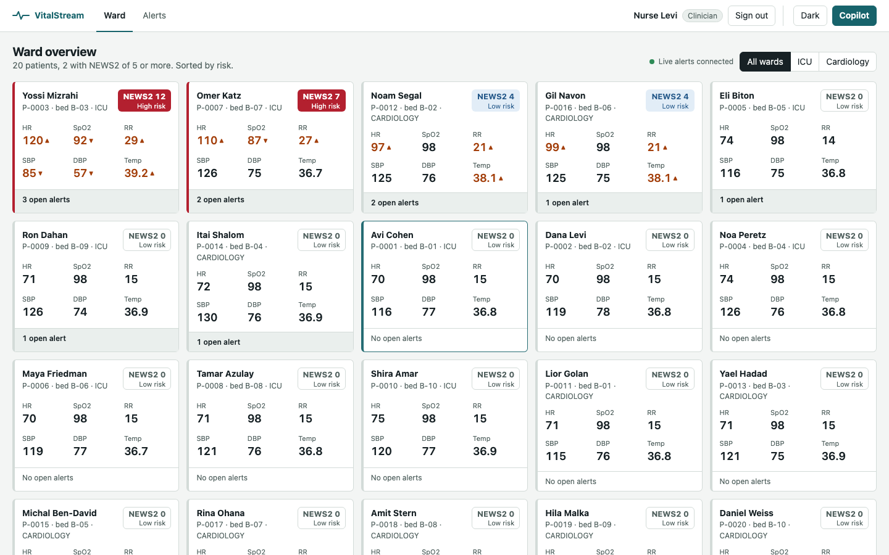
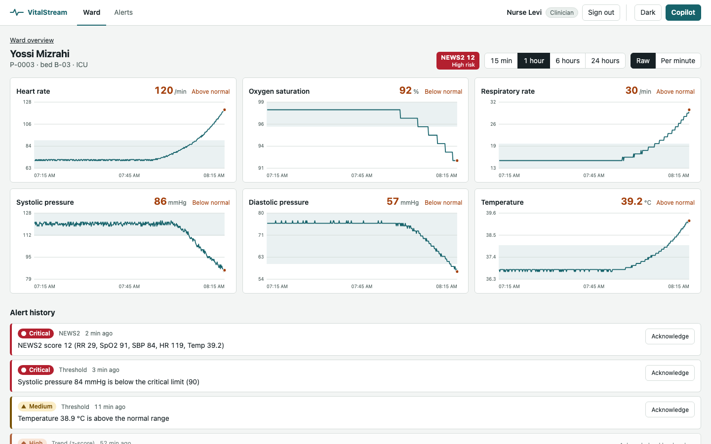
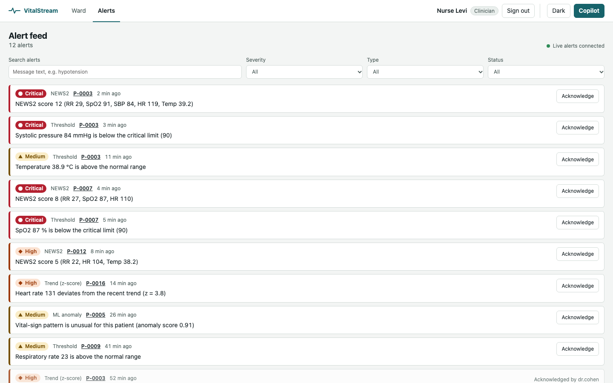
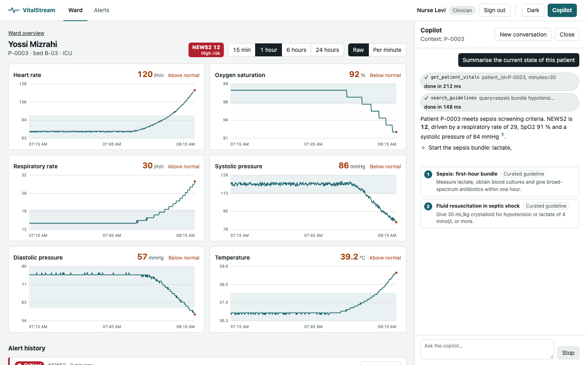
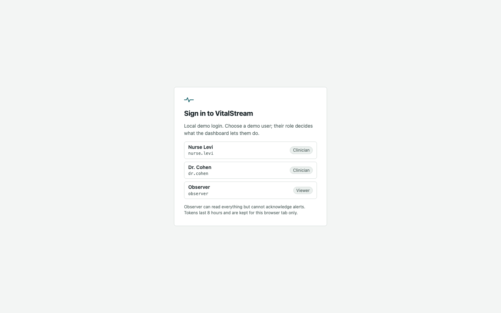

# dashboard

Clinician web UI for VitalStream: ward overview, patient detail with charts, alert feed with acknowledge, and a copilot chat panel. React 18, TypeScript (strict), Vite, Vitest + Testing Library, Playwright, MSW.

| Ward overview                                       | Patient detail                                            | Alert feed                                              | Copilot (mid-stream)                                      |
| --------------------------------------------------- | --------------------------------------------------------- | ------------------------------------------------------- | --------------------------------------------------------- |
|  |  |  |  |

## Sign in and roles

clinical-api requires a bearer token (CONTRACTS 4.2), so the dashboard opens on a dev sign-in screen with the three demo users:

| User       | `sub`        | Role        | Can acknowledge      |
| ---------- | ------------ | ----------- | -------------------- |
| Nurse Levi | `nurse.levi` | `CLINICIAN` | yes                  |
| Dr. Cohen  | `dr.cohen`   | `CLINICIAN` | yes                  |
| Observer   | `observer`   | `VIEWER`    | no (button disabled) |



Choosing a user calls `POST /clinical-api/api/v1/dev/token`, which only exists when clinical-api runs with `APP_ENV=dev` and no JWKS (otherwise sign-in explains that it is unavailable). The token is held in memory and `sessionStorage` (gone when the tab closes), never in `localStorage`, and is sent as `Authorization: Bearer` on every clinical-api call, including the alert SSE stream (`fetch` + `ReadableStream`, so it never appears in a URL). A 401 from the API, or the token's 8 h expiry, returns to the sign-in screen with a notice. The acknowledging user is the token owner: the request body carries only the optional `note`. The copilot calls carry no clinical token.

## Run

```bash
cd web/dashboard && npm ci
npm run dev:mock        # whole UI on MSW mocks (incl. the dev sign-in and 401/403 rules), no backend needed (http://localhost:5173)
npm run dev             # against real services (proxy targets below)
npm test                # Vitest, coverage gate on src/lib + src/hooks
npm run lint && npm run typecheck
npx playwright install chromium && npm run e2e      # e2e against dev:mock (port 25173)
npm run screenshots     # writes docs/images/dashboard-*.png (1440 light/dark, 390 mobile)
```

Stack: `make up` builds this folder's `Dockerfile` (nginx-unprivileged, port 3000, healthcheck `/healthz`) and serves http://127.0.0.1:3000.

Mock tuning via the page URL: `?streamMs=1500` (interval of live alerts), `?tokenMs=100` (copilot token delay), `?liveCopilot` (do not mock the copilot, use the real one).

## Configuration

| Variable                                       | Default                                            | Meaning                                       |
| ---------------------------------------------- | -------------------------------------------------- | --------------------------------------------- |
| `VITE_CLINICAL_API_URL`                        | `http://localhost:8082`                            | dev-server proxy target for `/clinical-api/*` |
| `VITE_COPILOT_URL`                             | `http://localhost:8083`                            | dev-server proxy target for `/copilot-api/*`  |
| `CLINICAL_API_URL` / `COPILOT_URL` (container) | `http://clinical-api:8082` / `http://copilot:8083` | nginx upstreams for the same prefixes         |
| `PORT`                                         | 5173                                               | dev server port                               |

The browser only calls same-origin prefixes (`/clinical-api`, `/copilot-api`), which the dev server and nginx forward, so no CORS is needed. Prefixes exist because both backends serve `/api/v1/...`.

## Design decisions

- **Severity is never colour alone.** Every badge carries a text label and a distinct shape (circle, triangle, diamond, octagon); out-of-range vitals get a visible arrow plus a screen-reader "high/low"; NEWS2 spells out its risk band; tool-call chips say running/done/failed. Light and dark themes (stored choice, else system), visible focus rings, skip link, reduced-motion respected.
- **fetch-based SSE** (`src/lib/sse.ts`) instead of `EventSource`, because `EventSource` cannot send `X-Correlation-Id` and cannot POST (the copilot chat is a POST). Alert stream reconnects with capped backoff and shows its state.
- **Copilot sessions.** The session id comes only from the server's `session` event and is echoed on follow-ups; the client never invents one. Model text is parsed into React elements by a small markdown subset (`src/lib/markdown.tsx`), so markup in an answer is shown as text; ESLint forbids `dangerouslySetInnerHTML`.
- **Optimistic acknowledge.** The row flips to Acknowledged immediately, then takes the server's answer; on 409 it fetches the alert and shows who got there first; other failures roll back with an error message.
- **NEWS2 on the tile** is computed client side from the latest vitals (the list endpoint has no score); it mirrors the stream-processor rule.
- **Reducers** (`chatReducer`, `liveAlertsReducer`) hold all streaming state transitions and are unit tested per event type.
- **API shapes** follow CONTRACTS section 4 "As built"; the client normalises tolerant variants (see `src/lib/api.ts`).
